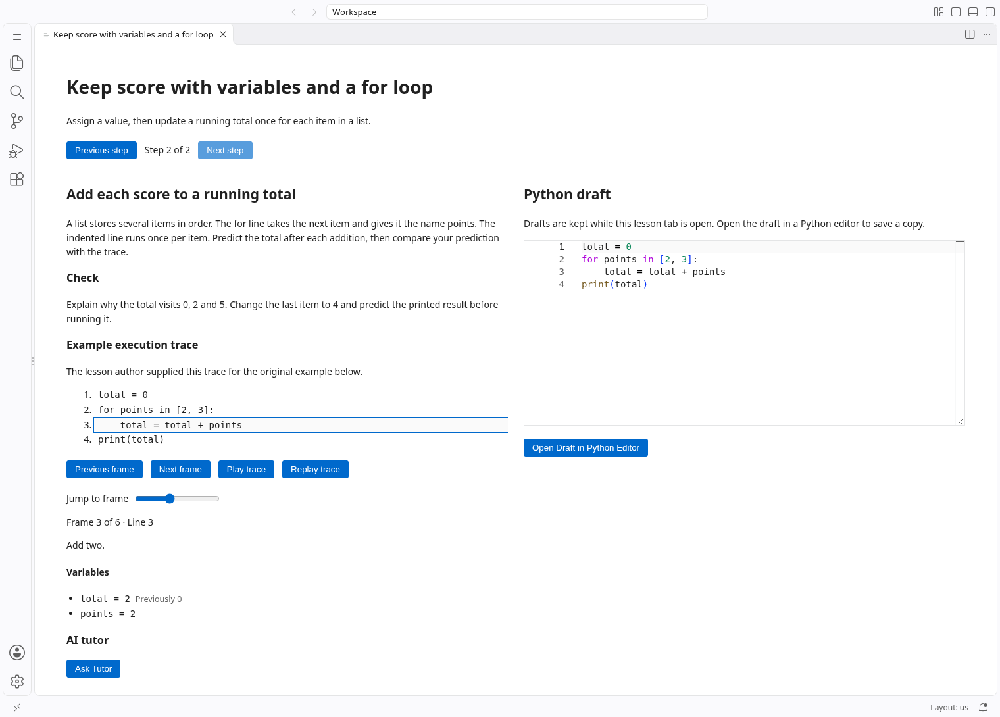

# TechMeCoding

TechMeCoding (TMC) is a Python learning environment for people who are new to programming. It brings step-by-step lessons, an editable code draft and execution playback into [Code - OSS](https://github.com/microsoft/vscode), the open-source foundation of Visual Studio Code.

The aim is to help learners explain what each line does, predict what happens next and test their reasoning. They can start with a short example and move on to real Python projects that use files, virtual environments, tests and Git.

*Learning Mode in the web workbench, paused after updating a running total.*

## How learning works

1. Use **File → Import Instructions…** to open a structured lesson. Start with [variables](docs/techmecoding/python-variables.tmc.json), try the [running total exercise](docs/techmecoding/variables-and-loop.tmc.json), or build a [first Python project](docs/techmecoding/first-python-project.tmc.json).
2. Read one step at a time, make a prediction and check your answer. Edit the Python draft beside the instructions and step through the lesson author’s example trace to see how values change.
3. On desktop, open the draft in a Python editor and save it as a `.py` file. Run or trace the saved file with a locally installed interpreter. Recorded playback can show the lines reached, local variables, call stacks, returned values and exceptions.
4. If you configure an OpenAI model, you can ask for hints or generate a lesson to review and save. Imported lessons, exercises and example playback work offline.

## Design

TMC adds a Learning Mode editor to the Code - OSS workbench. It reuses the editor, terminal and workspace services, so learners can keep using the same tools as their projects grow.

| Component | Role |
| --- | --- |
| Lesson format and importer | Validate versioned JSON and turn it into navigable steps, drafts, exercises and optional example traces. Markdown and plain text open in a normal editor. |
| Learning Mode | Shows instructions and an editable Python draft side by side. Each step retains its own draft while the lesson tab is open. |
| Desktop Python tools | Offer project virtual environments and package installation, then run or trace saved Python files after confirmation. The terminal shows programme output and errors. |
| Trace playback | Uses the same playback controls for labelled author-supplied examples and CPython recordings. Recorded frames can show calls, variable changes and names that refer to the same object. |
| Optional AI tutor and generator | Use a configured OpenAI model with consent before sending lesson context. Draft sharing is off by default. Generated lessons are validated and opened as JSON for review. |

## Build and project status

Windows x64 is the primary desktop target. The web workbench supports lesson import, exercises, draft editing and playback of example traces. Running local Python files, managing virtual environments and recording new traces use the desktop app. Windows packaging and the desktop smoke test are pending.

- [Windows build and smoke-test guide](docs/techmecoding/windows-build.md)
- [Lesson format and sample lessons](docs/techmecoding/lesson-format.md)
- [Project requirements and roadmap](docs/TMC_REQUIREMENTS.md)
- [Code - OSS development setup](CONTRIBUTING.md) and [development container](.devcontainer/README.md)

Report TMC issues in the [TechMeCoding issue tracker](https://github.com/clark-2468/TMC/issues). For the upstream editor and its contribution process, see the [Code - OSS repository](https://github.com/microsoft/vscode).

## Licence

Code - OSS is copyright (c) Microsoft Corporation and licensed under the [MIT licence](LICENSE.txt). See the [third-party notices](ThirdPartyNotices.txt) for bundled components.
